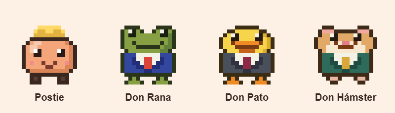

<div align="center">

<!-- TODO: add the logo at docs/media/logo.png -->


# claude-npc

**A desktop NPC for Claude Code that reacts to what Claude does, asks you for permissions and lets you send it tasks.**

[](LICENSE)
[](docs/testing.md)
[](MVP.md)
[](https://tauri.app)
[](docs/features.md)

English · UI in Español, English, Português, Français, Deutsch


### [⬇ Download for Windows](https://github.com/Javierif/agent-npc/releases) <!-- TODO: link to the real installer once published -->

</div>

Postie, a little peach-colored blob with a sticky note for a hat, walks along the top of your taskbar. It sees what your Claude Code sessions are doing, shows you when it needs you, and can launch tasks for you, including the ones you write in your Obsidian notes.

## Why you'll like it

- **It reacts to Claude Code.** Thinking, working, juggling subagents, alert when it needs you, happy when done, sad when something fails.
- **Approve permissions without leaving what you're doing.** A card next to the NPC with **Allow / Deny**, global shortcuts `Ctrl+Alt+Y` / `Ctrl+Alt+N`, or approve from Telegram. Claude's questions and plans are answered in the session panel.
- **Send it tasks.** Write a task, pick a folder and it runs `claude -p` with your own session, shows progress and leaves the answer as a sticky note. Tasks are read-only unless you allow edits.
- **Obsidian, no plugin.** Write `- [ ] something #claude` in any note: press ▶ and Claude does it and writes the answer under the task.
- **Quota rings.** See your 5 h / 7 d usage and the context window at a glance.
- **Characters and themes.** Postie, Don Rana (frog), Don Pato (duck) and Don Hámster (hamster), custom themes and Codex Pets.
- **Optional memory (Cerebro).** Off by default: your Obsidian vault becomes Claude's memory, with reflections, lessons and a personality that grows from how you work.

It is **local first**: no backend, no telemetry, no accounts. It uses your own `claude` CLI and subscription.

## Install

**Easiest:** download the installer from [Releases](https://github.com/Javierif/agent-npc/releases) <!-- TODO: not published yet -->.

<details>
<summary>Or run it from source</summary>

Requirements: Node 20+, Rust (recent stable), WebView2 and `claude` on the PATH with a signed-in session.

```bash
npm install
npm run tauri dev
```

</details>

## Quick start

1. **Run it.** Hover over the character to see the menu (tasks, sessions, Obsidian, settings). Quit from the system tray icon. If `claude` is not signed in, the NPC offers *Iniciar sesión* (Sign in).
2. **Connect it.** In **Sesiones** (Sessions) or **Ajustes** (Settings), press *Conectar con Claude Code* (Connect to Claude Code). It adds HTTP hooks to `~/.claude/settings.json`, keeping yours and saving a backup.
3. **Restart your open Claude Code sessions** so they pick up the hooks.

Without the hooks the NPC is still useful for launching tasks. More in [Integrations](docs/integrations.md).

## Characters

<p align="center">
  <br>
  <sub>Postie · Don Rana · Don Pato · Don Hámster</sub>
</p>

## Docs

| | |
|---|---|
| [Features](docs/features.md) | The complete feature list |
| [Obsidian](docs/obsidian.md) | `#claude` tasks, context, shortcuts and commands |
| [Cerebro](docs/cerebro.md) | Vault memory, reflection, personality, dreaming |
| [Integrations](docs/integrations.md) | Connecting Claude Code, quota, Telegram, Slack/Feishu, mobile view, WSL/SSH, other agents |
| [Themes and pets](docs/themes.md) | Custom themes, install by URL, Codex Pets |
| [Security](docs/security.md) | What it can and cannot do |
| [Tests and status](docs/testing.md) | Tests and what has actually been verified |
| [MVP](MVP.md) | The scope of this version |

## Status

**MVP.** Tested on Windows 11; macOS and Linux are written but neither compiled nor tested. Much of the Obsidian, memory and integration work has only been checked with unit tests and simulations, not against real services. [docs/testing.md](docs/testing.md) says exactly what was and was not verified.

## Compared to clawd-on-desk

[clawd-on-desk](https://github.com/rullerzhou-afk/clawd-on-desk) was a conceptual inspiration; no code or art was copied (it is AGPL-3.0).

| clawd-on-desk feature | Here |
|---|---|
| Animated states by agent | ✅ Claude Code; bridges for Gemini, Cursor and Codex; generic endpoint |
| Permission bubbles + global shortcut | ✅ |
| Approve from Telegram | ✅ |
| Slack / Feishu notices | ✅ notices only (Feishu without interactive approval) |
| Sessions panel + jump to the terminal | ✅ by folder name; if it cannot find it, it opens one that resumes the session |
| Quota rings | ✅ requires configuring the `statusLine` |
| Mobile view | ✅ read-only, PWA |
| Mini mode | ✅ right edge |
| Eye tracking, sleeping, click reaction | ✅ |
| Themes | ✅ 4 palettes, custom themes, installable by URL and Codex Pets import (tested with a synthetic one). No official catalog or Live2D |
| 25+ agents with their own integration | ◐ Claude Code, Gemini, Cursor and Codex; the rest through the generic endpoint |
| macOS / Linux | ◐ code written, untested |
| WSL / remote SSH | ◐ copy the hooks + `ssh -R` tunnel or WSL2 *mirrored*; untested |
| Several languages | ✅ 5 languages |
| **Send tasks to Claude** | ✅ (clawd-on-desk does not do this) |
| **Obsidian** | ✅ (clawd-on-desk does not have it) |
| **Memory from the vault** | ◐ optional; reflection and personality tried by hand by the author with a real vault and a real `claude`, with no formal check; the rest untested with a real Obsidian or Claude Code (clawd-on-desk does not have it) |

## Licenses

MIT. Third-party attributions are in `NOTICE`. The character is original.

Documentation and code comments are in English. UI labels shown in Spanish are the dictionary keys in `src/i18n.ts`, so the docs keep them verbatim in *italics*, with an English gloss on first use.
